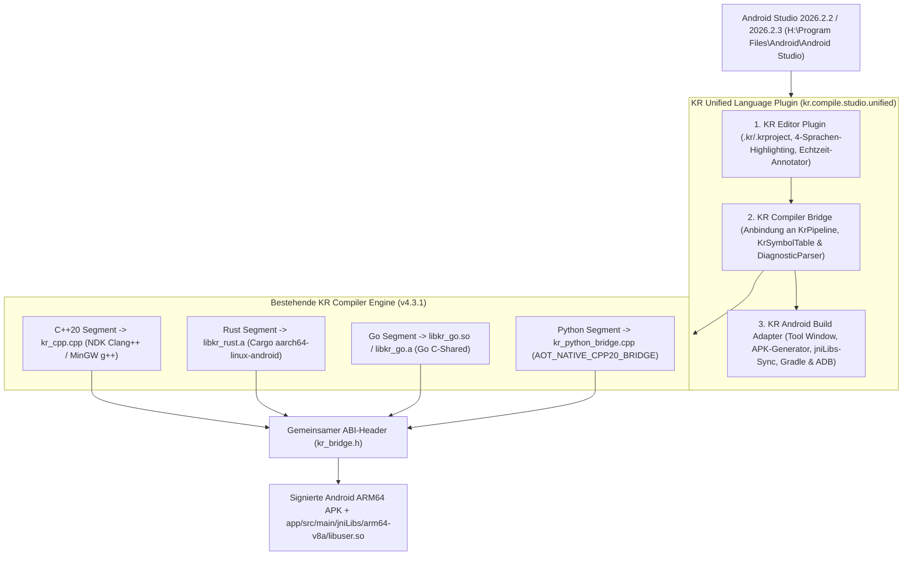

# Handbuch: KR Unified Language Plugin für Android Studio (Rabbit 2 & Rabbit 3)

**Version:** 4.3.1  
**Unterstützte Ziel-IDEs:**
- **Android Studio Rabbit 3 | 2026.2.3 Canary 2** (`Build #AI-262.10968.63.2623.16736312`, `AndroidStudio2026.2.3`)
- **Android Studio Rabbit 2 Canary 2 & Stable** (`2026.2.2.2`, `Build #AI-262.10315.125.2622.16434108`, `AndroidStudio2026.2.2`)
- Sowie alle weiteren IntelliJ-2024.x bis 2026.x+ basierten Android-Studio-Versionen (`<idea-version since-build="241.0"/>` ohne Versionsobergrenze)

**Installationsort Android Studio:** `H:\Program Files\Android\Android Studio`  
**KR Engine & Toolchain-Stammverzeichnis:** `H:\KR-Compiler\KR-Compiler-Windows-x64-v4.3.1`  
**Unterstützte Sprachen in `.kr`:** **C++20** (Native) · **Rust** (Rules) · **Go** (Services) · **Python** (Logic)

---

## ⚠️ 1. Wichtige Voraussetzungen für Entwickler & Nutzer (Bitte zuerst lesen!)

> **WICHTIG: Das Android-Studio-Plugin (`KR-Unified-Language-AndroidStudio-Plugin-v4.3.1.zip`) funktioniert NICHT ohne die zugehörige KR Compiler IDE!**
>
> Das Plugin (~356 KB) ist bewusst keine Kopie des Compilers, sondern eine schlanke **3-Schichten-Brücke** für Android Studio. Für die eigentliche Kompilierung der 4 Sprachen (C++20, Rust, Go, Python) auf Android ARM64, Windows x64 und Linux x64 greift das Plugin auf die **KR Compiler IDE** und deren portable **`toolchain/`** zurück.

### Was jeder Entwickler & Nutzer zwingend benötigt:

1. **KR Compiler IDE (v4.3.1 – Windows x64):**
   - Laden Sie das vollständige Release-Archiv `KR-Compiler-Windows-x64-v4.3.1.zip` von [GitHub Releases](https://github.com/kruemmel-python/KR-Compiler-Windows-x64-v4.3.1/releases) herunter (oder klonen Sie das Repository und führen Sie `download-toolchain.ps1` sowie `provision-runtime.ps1` aus).
   - Der Ordner muss die Unterverzeichnisse **`toolchain/`** (mit MinGW/Clang, Rust/Cargo, Go, Zig, `android/runner-template.apk`), **`runtime/jdk/`** und **`dist/KR-Compiler-IDE.jar`** enthalten.
2. **Android Studio + Android SDK & NDK:**
   - Android Studio (z. B. Rabbit 2 `2026.2.2` oder Rabbit 3 `2026.2.3`).
   - Im Android Studio *SDK Manager* müssen installiert sein:
     - **Android SDK Platform-Tools** (`adb.exe`)
     - **Android SDK Build-Tools** (`35.0.0` oder `36.0.0` für `apksigner.bat`)
     - **NDK (Side by side)** (empfohlen: `28.2.13676358` unter `%LOCALAPPDATA%\Android\Sdk\ndk\`)
3. **Verknüpfung in Android Studio herstellen:**
   - Wenn Ihre KR Compiler IDE nicht unter den Standardpfaden (`H:\KR-Compiler\KR-Compiler-Windows-x64-v4.3.1` oder `C:\KR-Compiler\KR-Compiler-Windows-x64-v4.3.1`) liegt, klicken Sie im unteren Android-Studio-ToolWindow **`KR Unified Language`** einfach auf den Button **`KR-Engine Pfad…`** und wählen Sie Ihren entpackten Ordner `KR-Compiler-Windows-x64-v4.3.1` aus (oder setzen Sie die Umgebungsvariable `KR_COMPILER_HOME`).

---

## 2. Architektur-Überblick

Das **KR Unified Language Plugin** (`kr.compile.studio.unified`) erweitert Android Studio um die Fähigkeit, `.kr`- und `.krproject`-Dateien mit vier Programmiersprachen innerhalb eines einzigen Projekts zu bearbeiten, sprachübergreifend zu prüfen und über die bestehende KR-Pipeline als Android-ARM64-App (`.apk` + `app/src/main/jniLibs/arm64-v8a`) oder Desktop-Binärdatei (`.exe` / ELF) zu kompilieren.



---

## 2. Installation & Update-Sicherheit in Android Studio

### Weg A: Bereits vorinstalliert & aktiviert (Sofort einsatzbereit)
Das Plugin ist bereits im offiziellen **Benutzer-Plugin-Verzeichnis** deiner Android-Studio-Installation eingerichtet und aktiviert:
- **Android Studio 2026.2.3 (Rabbit 3 Canary 2):**
  `C:\Users\ralfk\AppData\Roaming\Google\AndroidStudio2026.2.3\plugins\kr-unified-language\lib\kr-unified-language.jar`
- **Android Studio 2026.2.2 (Rabbit 2 Canary 2):**
  `C:\Users\ralfk\AppData\Roaming\Google\AndroidStudio2026.2.2\plugins\kr-unified-language\lib\kr-unified-language.jar`

> **Wichtiger Hinweis für Android-Studio-Updates:**
> Drittanbieter-Plugins liegen ausschließlich unter `%APPDATA%\Google\AndroidStudio*\plugins\` und **nicht** im Programmordner `H:\Program Files\Android\Android Studio\plugins\`. Dadurch laufen zukünftige Android-Studio-Patch-Updates komplett ohne Dateikonflikte durch, und Android Studio migriert das Plugin beim Versionswechsel automatisch mit.

---

### Weg B: Manuelle Installation über die Oberfläche (`Install Plugin from Disk...`)
Falls du das Plugin auf einem anderen PC oder manuell über die Oberfläche installieren möchtest:

1. Öffne **Android Studio** (`H:\Program Files\Android\Android Studio\bin\studio64.exe`).
2. Navigiere zu **`File → Settings...`** (bzw. im Startfenster auf **`Plugins`**).
3. Wähle links **`Plugins`**.
4. Klicke oben rechts auf das **Zahnrad-Symbol (`⚙️`)** und wähle **`Install Plugin from Disk...`**.
5. Wähle das installierbare Plugin-ZIP aus:
   - Direkt aus dem `dist/`-Ordner:
     `H:\KR-Compiler\KR-Compiler-Windows-x64-v4.3.1\dist\KR-Unified-Language-AndroidStudio-Plugin-v4.3.1.zip`
   - Oder aus dem Komplettpaket (`1_Plugin\KR-Unified-Language-AndroidStudio-Plugin-v4.3.1.zip`).
6. Bestätige mit **`OK`** und starte Android Studio bei Aufforderung neu (**`Restart IDE`**).

---

### Weg C: Plugin per Skript neu bauen & installieren
Nach eigenen Anpassungen am KR-Compiler (`src/`) oder am Plugin (`android-studio-plugin/src/`) genügt ein Aufruf in PowerShell:

```powershell
powershell -NoProfile -ExecutionPolicy Bypass -File "H:\KR-Compiler\KR-Compiler-Windows-x64-v4.3.1\build-android-studio-plugin.ps1"
```

---

## 3. Das mitgelieferte 4-Sprachen-Beispielprojekt in Android Studio laden

Im Komplettpaket sowie im Projektordner liegt ein **vollständiges, sofort in Android Studio ladbares Android-Gradle- & KR-Beispielprojekt** bereit:

- **Direkter Pfad im Workspace:**
  `H:\KR-Compiler\KR-Compiler-Windows-x64-v4.3.1\examples\KR_ANDROID_STUDIO_4LANG_DEMO`
- **Pfad im Komplettpaket-ZIP:**
  `3_Beispielprojekt_4_Sprachen_Demo\KR_ANDROID_STUDIO_4LANG_DEMO`

### Projektstruktur des Beispielprojekts
```text
KR_ANDROID_STUDIO_4LANG_DEMO/
├── main.kr                         # 4-Sprachen-Quelldatei (C++20 + Rust + Go + Python)
├── project.krproject               # KR-Projektkonfiguration (inkl. Python-Strategie)
├── kr-android-bridge.gradle.kts    # KR Android Build Adapter für Gradle
├── settings.gradle.kts             # Android Studio Gradle-Projektdefinition
├── build.gradle.kts                # Root-Gradle-Buildskript (AGP 9.5.0 + KR-Bridge)
├── gradle.properties               # JVM- & AndroidX-Einstellungen
├── gradlew / gradlew.bat           # Gradle Wrapper (9.6.1)
├── app/
│   ├── build.gradle.kts            # Android-App-Modul (arm64-v8a, ruft vor preBuild KR auf)
│   └── src/main/
│       ├── AndroidManifest.xml     # App-Manifest für MainActivity
│       ├── java/kr/compile/studio/demo4lang/
│       │   └── MainActivity.java   # Lädt libuser.so & libkr_go.so und zeigt das 4-Sprachen-Ergebnis
│       └── jniLibs/arm64-v8a/      # Automatisch durch KR erzeugte native ARM64-Bibliotheken:
│           ├── libuser.so          # C++20 + Rust + Python AOT + JNI-Einstiegspunkt
│           ├── libkr_go.so         # Go Shared Library (ARM64)
│           └── libc++_shared.so    # Android NDK C++ Runtime
└── KR_BUILD/                       # Ausgabeverzeichnis der KR-Pipeline (APK, .exe, kr_bridge.h)
```

### So öffnest und startest du das Beispielprojekt in Android Studio:

1. Klicke in Android Studio auf **`File → Open...`**.
2. Wähle den Ordner:
   `H:\KR-Compiler\KR-Compiler-Windows-x64-v4.3.1\examples\KR_ANDROID_STUDIO_4LANG_DEMO`
   und klicke auf **`OK`**.
3. **`.kr`-Datei im Editor öffnen:**
   - Öffne unten das Tool-Window **`KR Unified Language`** und klicke in dessen Werkzeugleiste auf **`main.kr öffnen`** *(oder doppelklicke auf eine beliebige Zeile in der Tabelle `Sprachsegmente & ABI`)*.
   - Alternativ kannst du links oben im Projektexplorer die Ansicht von `Android` auf **`Project`** umschalten und `main.kr` direkt anklicken.
4. **Kompilieren & Ausführen:**
   - **Über das KR Tool-Window (schnellster Weg):** Wähle im Dropdown `Android ARM64 (.apk)` (oder `Windows x64 (.exe)`) und klicke auf **`KR Build starten`** bzw. **`APK bauen & auf Gerät starten (ADB)`**.
   - **Über den Standard-Run-Button von Android Studio (`▶ Run 'app'`):** Beim Starten des regulären Gradle-Builds führt `app/build.gradle.kts` automatisch vor `preBuild` den Task `compileKrUnifiedAndroidArm64` aus, aktualisiert `jniLibs/arm64-v8a/libuser.so` und startet `MainActivity` auf dem Gerät/Emulator.

---

## 4. Arbeiten im `.kr`-Mehrsprachen-Editor & Tool-Window

### Mehrsprachige Syntaxhervorhebung & Echtzeit-Diagnose

| Sprache | Erkennungsmerkmale in `.kr` | Farbakzent im Editor | Kompilierungsziel (Android ARM64) |
| :--- | :--- | :--- | :--- |
| **C++20** | `#include <...>`, `int main(...)`, `void foo(...)` | **Blau** (`#569CD6`) | `kr_cpp.cpp` → `libuser.so` (NDK Clang++) |
| **Rust** | `pub fn ...`, `fn ... -> ...`, `let mut`, `#[no_mangle]` | **Orange** (`#EB874B`) | `rust_module/src/lib.rs` → `libkr_rust.a` |
| **Go** | `package main`, `func ...(...) ...`, `var` | **Türkis** (`#4EC9B0`) | `go_module/main.go` → `libkr_go.so` |
| **Python** | `def ...(...) -> ...:`, `elif`, `else:`, `# Kommentar` | **Violett** (`#C586C0`) | `python_module/kr_python_bridge.cpp` → `libuser.so` |

### Die Knöpfe im Tool-Window `KR Unified Language`
1. **`Ziel:`** – Wählt die Zielplattform (`Android ARM64 (.apk)`, `Windows x64 (.exe)`, `Linux x64 (ELF)`).
2. **`main.kr öffnen`** – Öffnet `main.kr` (bzw. die erste `.kr`-Datei im Projekt) direkt im Editor, unabhängig davon, ob der Projektexplorer auf `Android`- oder `Project`-Ansicht steht.
3. **`Sprachsegmente analysieren`** – Zerlegt alle `.kr`-Dateien in C++-, Rust-, Go- und Python-Blöcke und zeigt alle Funktionssignaturen sowie sprachübergreifenden Aufrufe in der Tabelle an.
4. **`KR Build starten`** – Führt den kompletten KR-Build durch und gibt alle Schritte live in der rechten Konsole aus.
5. **`APK bauen & auf Gerät starten (ADB)`** – Baut die signierte ARM64-APK, installiert sie per `adb install -r` auf einem verbundenen Gerät/Emulator und startet sie.
6. **`Gradle-Bridge erzeugen`** – Erzeugt `kr-android-bridge.gradle.kts`.
7. **`4-Sprachen-Demo erzeugen`** – Erzeugt in einem beliebigen Projektordner auf Knopfdruck das komplette 4-Sprachen-Beispielprojekt inklusive Android-Gradle-Dateien und öffnet `main.kr`.

### Tastenkombinationen & Menü-Aktionen
Unter **`Tools → KR Unified Language (C++ / Rust / Go / Python)`** (sowie im Rechtsklick-Kontextmenü jeder `.kr`-Datei):
- **`Ctrl + Alt + K`** – *KR: Projekt kompilieren & Android ARM64 APK bauen*
- **`Ctrl + Alt + Shift + K`** – *KR: Android ARM64 APK bauen & auf Gerät starten (ADB)*
- *KR: 4-Sprachen-Projektvorlage (C++ / Rust / Go / Python) initialisieren*

---

## 5. Wie die 4 Sprachen in `main.kr` zusammenarbeiten

```cpp
#include <iostream>
#include <cstdint>

// 1. [RUST] Sicherheits- und Regelprüfung (wird zu libkr_rust.a kompiliert)
pub fn rust_security_rule(seed: i32, factor: i32) -> i32 {
    let mut acc: i32 = seed * factor;
    if acc < 100 {
        acc = acc + 42;
    }
    acc
}

// 2. [GO] Service-Orchestrierung (wird zu libkr_go.so / libkr_go.a kompiliert)
package main

func go_dispatch_service(ruleScore int32, nodes int32) int32 {
    var total int32 = ruleScore + (nodes * 15)
    return total
}

# 3. [PYTHON] Auswertungslogik (Android-Strategie: AOT_NATIVE_CPP20_BRIDGE)
# Ruft direkt die Rust-Funktion rust_security_rule() auf!
def python_evaluate_logic(service_val: int32, bonus: int32) -> int32:
    verified = rust_security_rule(bonus, 3)
    combined = service_val + verified
    if combined > 200:
        print("[KR-PYTHON] Hoher Score erreicht:", combined)
        return combined + 50
    else:
        print("[KR-PYTHON] Standard-Score:", combined)
        return combined

// 4. [C++20] Nativer Haupteinstiegspunkt (ruft Rust, Go und Python direkt auf)
int main(int argc, char** argv) {
    (void)argc; (void)argv;
    int32_t rustVal = rust_security_rule(20, 4);
    int32_t goVal   = go_dispatch_service(rustVal, 6);
    int32_t pyVal   = python_evaluate_logic(goVal, 10);
    std::cout << "Gesamtergebnis = " << pyVal << std::endl;
    return (pyVal == 334) ? 0 : 1;
}
```

### Berechnungsfluss (Verifiziert mit Exit-Code `0`)
1. **Rust:** `rust_security_rule(20, 4)` → `20 * 4 = 80` (`< 100` → `+ 42`) = **`122`**
2. **Go:** `go_dispatch_service(122, 6)` → `122 + (6 * 15)` = **`212`**
3. **Python (mit Cross-Call nach Rust):**
   - Ruft `rust_security_rule(10, 3)` auf → `30 + 42 = 72`
   - `combined = 212 + 72 = 284` (`> 200` → `+ 50`) = **`334`**
   - Gibt `[KR-PYTHON] Hoher Score erreicht: 284` auf `stdout` und im Android-Logcat (Tag `KR_PYTHON`) aus.
4. **C++20 & Android JNI:** Prüft `pyVal == 334` und liefert Exit-Code **`0`** an die Konsole bzw. an `MainActivity` zurück.
