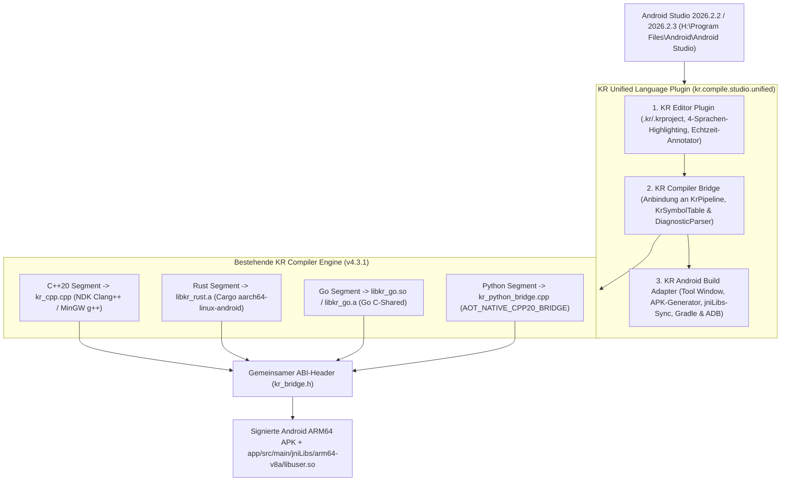

# Handbuch: KR Unified Language Plugin für Android Studio (Rabbit 2 & Rabbit 3)

> [!IMPORTANT]
> **Bereits installiert & für Android Studio 2026.2.2 + 2026.2.3 verifiziert:**
> - **Benutzer-Plugin (Rabbit 3 | 2026.2.3 Canary 2):** `C:\Users\ralfk\AppData\Roaming\Google\AndroidStudio2026.2.3\plugins\kr-unified-language`
> - **Benutzer-Plugin (Rabbit 2 | 2026.2.2 Canary 2):** `C:\Users\ralfk\AppData\Roaming\Google\AndroidStudio2026.2.2\plugins\kr-unified-language`
> - **Komplettpaket-ZIP (Plugin + Handbuch + Beispielprojekt):** [KR-Android-Studio-Plugin-und-Handbuch-v4.3.1.zip](file:///h:/KR-Compiler/KR-Compiler-Windows-x64-v4.3.1/KR-Android-Studio-Plugin-und-Handbuch-v4.3.1.zip)
> - **Installierbares Plugin-ZIP (`Install Plugin from Disk...`):** [KR-Unified-Language-AndroidStudio-Plugin-v4.3.1.zip](file:///h:/KR-Compiler/KR-Compiler-Windows-x64-v4.3.1/dist/KR-Unified-Language-AndroidStudio-Plugin-v4.3.1.zip)
> - **Fertiges Android-Studio-Beispielprojekt:** [`examples/KR_ANDROID_STUDIO_4LANG_DEMO`](file:///h:/KR-Compiler/KR-Compiler-Windows-x64-v4.3.1/examples/KR_ANDROID_STUDIO_4LANG_DEMO)

---

## ⚠️ Wichtige Voraussetzungen für Entwickler & Nutzer (Warum das Plugin die KR Compiler IDE benötigt)

> [!WARNING]
> **Das Android Studio Plugin allein reicht nicht aus – die KR Compiler IDE muss ebenfalls vorhanden sein!**
> Das Plugin (`KR-Unified-Language-AndroidStudio-Plugin-v4.3.1.zip`, ~356 KB) ist die Verbindungsbrücke in Android Studio und enthält bewusst keinen zweiten Compiler. Es steuert im Hintergrund die **KR Compiler IDE** inklusive ihrer portablen **`toolchain/`** (Clang++/MinGW, Rust/Cargo, Go, Zig, Android-Runner-Template) und **`runtime/jdk/`** an.

### Checkliste für Entwickler & Nutzer:
1. **KR Compiler IDE (`KR-Compiler-Windows-x64-v4.3.1.zip`)**:
   - Von [GitHub Releases](https://github.com/kruemmel-python/KR-Compiler-Windows-x64-v4.3.1/releases) herunterladen und entpacken (z. B. nach `C:\KR-Compiler\KR-Compiler-Windows-x64-v4.3.1` oder `H:\KR-Compiler\KR-Compiler-Windows-x64-v4.3.1`).
   - Wer nur das Git-Repository klont, führt einmalig `download-toolchain.ps1` und `provision-runtime.ps1` aus, damit `toolchain/` und `runtime/jdk/` vorhanden sind.
2. **Android Studio + Android SDK & NDK**:
   - Im Android Studio *SDK Manager* unter *SDK Tools* müssen **NDK (Side by side)** (z. B. `28.2.13676358`), **Android SDK Build-Tools** (`35.0.0+` für `apksigner`) und **Android SDK Platform-Tools** (`adb`) installiert sein.
3. **KR Unified Language Plugin in Android Studio installieren**:
   - Über `Settings → Plugins → ⚙️ → Install Plugin from Disk...` die Datei `KR-Unified-Language-AndroidStudio-Plugin-v4.3.1.zip` installieren.
4. **KR-Engine-Pfad in Android Studio verknüpfen**:
   - Im unteren Tool-Window **`KR Unified Language`** auf **`KR-Engine Pfad…`** klicken und das entpackte Verzeichnis `KR-Compiler-Windows-x64-v4.3.1` auswählen *(oder die Umgebungsvariable `KR_COMPILER_HOME` setzen)*.

---

## 1. Architektur-Überblick

Das **KR Unified Language Plugin** (`kr.compile.studio.unified`) integriert deine bestehende **KR Compiler Engine (v4.3.1)** in drei Schichten in Android Studio, sodass **C++20, Rust, Go und Python** in `.kr`-Dateien gemeinsam bearbeitet, geprüft und zu einer Android-ARM64-App (`.apk` + `app/src/main/jniLibs/arm64-v8a`) kompiliert werden.



---

## 2. Installation & Update-Verhalten in Android Studio

### Option 1: Direkt starten (bereits installiert & aktiviert)
Das Plugin liegt im offiziellen Benutzer-Plugin-Ordner (`%APPDATA%\Google\AndroidStudio2026.2.3\plugins\kr-unified-language`) und wird bei Android-Studio-Updates automatisch übernommen, ohne Dateikonflikte im Programmordner `H:\Program Files\Android\Android Studio` auszulösen.

### Option 2: Manuelle Installation über `Install Plugin from Disk...`
1. Öffne **Android Studio** (`H:\Program Files\Android\Android Studio\bin\studio64.exe`).
2. Öffne **`File → Settings... → Plugins`**.
3. Klicke oben rechts auf das **Zahnrad-Symbol (`⚙️`)** → **`Install Plugin from Disk...`**.
4. Wähle [KR-Unified-Language-AndroidStudio-Plugin-v4.3.1.zip](file:///h:/KR-Compiler/KR-Compiler-Windows-x64-v4.3.1/dist/KR-Unified-Language-AndroidStudio-Plugin-v4.3.1.zip) aus.
5. Klicke auf **`OK`** und anschließend auf **`Restart IDE`**.

### Option 3: Automatischer Neu-Build per PowerShell
Nach Änderungen am Quellcode führst du einfach [build-android-studio-plugin.ps1](file:///h:/KR-Compiler/KR-Compiler-Windows-x64-v4.3.1/build-android-studio-plugin.ps1) aus:
```powershell
powershell -NoProfile -ExecutionPolicy Bypass -File "H:\KR-Compiler\KR-Compiler-Windows-x64-v4.3.1\build-android-studio-plugin.ps1"
```

---

## 3. Das mitgelieferte 4-Sprachen-Beispielprojekt in Android Studio laden

Das Projekt [`examples/KR_ANDROID_STUDIO_4LANG_DEMO`](file:///h:/KR-Compiler/KR-Compiler-Windows-x64-v4.3.1/examples/KR_ANDROID_STUDIO_4LANG_DEMO) (und im Komplettpaket-ZIP unter `3_Beispielprojekt_4_Sprachen_Demo/KR_ANDROID_STUDIO_4LANG_DEMO`) ist ein vollständiges Android-Studio-Gradle-Projekt kombiniert mit einer 4-Sprachen-`.kr`-Quelldatei:

- [main.kr](file:///h:/KR-Compiler/KR-Compiler-Windows-x64-v4.3.1/examples/KR_ANDROID_STUDIO_4LANG_DEMO/main.kr) – 4-Sprachen-Quelldatei (C++20, Rust, Go, Python)
- [project.krproject](file:///h:/KR-Compiler/KR-Compiler-Windows-x64-v4.3.1/examples/KR_ANDROID_STUDIO_4LANG_DEMO/project.krproject) – KR-Projektkonfiguration (`python_android_strategy = "AOT_NATIVE_CPP20_BRIDGE"`)
- [kr-android-bridge.gradle.kts](file:///h:/KR-Compiler/KR-Compiler-Windows-x64-v4.3.1/examples/KR_ANDROID_STUDIO_4LANG_DEMO/kr-android-bridge.gradle.kts) – Gradle-Task `compileKrUnifiedAndroidArm64`
- [settings.gradle.kts](file:///h:/KR-Compiler/KR-Compiler-Windows-x64-v4.3.1/examples/KR_ANDROID_STUDIO_4LANG_DEMO/settings.gradle.kts) & [build.gradle.kts](file:///h:/KR-Compiler/KR-Compiler-Windows-x64-v4.3.1/examples/KR_ANDROID_STUDIO_4LANG_DEMO/build.gradle.kts) – Root-Gradle-Konfiguration
- [app/build.gradle.kts](file:///h:/KR-Compiler/KR-Compiler-Windows-x64-v4.3.1/examples/KR_ANDROID_STUDIO_4LANG_DEMO/app/build.gradle.kts) – Android-App-Modul (`arm64-v8a`, führt vor `preBuild` automatisch die KR-Pipeline aus)
- [MainActivity.java](file:///h:/KR-Compiler/KR-Compiler-Windows-x64-v4.3.1/examples/KR_ANDROID_STUDIO_4LANG_DEMO/app/src/main/java/kr/compile/studio/demo4lang/MainActivity.java) – Lädt `libc++_shared.so`, `libkr_go.so` und `libuser.so` und führt den 4-Sprachen-Code per JNI aus

### Schritt-für-Schritt: Beispielprojekt öffnen & starten
1. Wähle in Android Studio **`File → Open...`**.
2. Öffne den Ordner `H:\KR-Compiler\KR-Compiler-Windows-x64-v4.3.1\examples\KR_ANDROID_STUDIO_4LANG_DEMO`.
3. Klicke am unteren Fensterrand auf das Tool-Window **`KR Unified Language`** und dort auf den Button **`main.kr öffnen`** *(oder schalte links oben im Projektbaum von der Ansicht `Android` auf `Project` um und öffne `main.kr`)*.
4. Klicke im Tool-Window auf **`KR Build starten`** (oder **`APK bauen & auf Gerät starten (ADB)`**), um die 4 Sprachen sofort zu kompilieren und auszuführen.

---

## 4. Nutzung des `.kr`-Editors & Tool-Windows

### Sprachblöcke & Farben im `.kr`-Editor

| Sprache | Erkennungsmerkmale in `.kr` | Farbakzent im Editor | Kompilierungsziel (Android ARM64) |
| :--- | :--- | :--- | :--- |
| **C++20** | `#include <...>`, `int main(...)`, `void foo(...)` | **Blau** (`#569CD6`) | `kr_cpp.cpp` → `libuser.so` (NDK Clang++) |
| **Rust** | `pub fn ...`, `fn ... -> ...`, `let mut`, `#[no_mangle]` | **Orange** (`#EB874B`) | `rust_module/src/lib.rs` → `libkr_rust.a` |
| **Go** | `package main`, `func ...(...) ...`, `var` | **Türkis** (`#4EC9B0`) | `go_module/main.go` → `libkr_go.so` |
| **Python** | `def ...(...) -> ...:`, `elif`, `else:`, `# Kommentar` | **Violett** (`#C586C0`) | `python_module/kr_python_bridge.cpp` → `libuser.so` |

### Funktionen des Tool-Windows `KR Unified Language`
- **`Ziel:`** – Wählt zwischen `Android ARM64 (.apk)`, `Windows x64 (.exe)` und `Linux x64 (ELF)`.
- **`main.kr öffnen`** – Öffnet `main.kr` direkt im Editor.
- **`Sprachsegmente analysieren`** – Aktualisiert die Übersicht aller C++-, Rust-, Go- und Python-Segmente sowie der `extern "C"`-Brücken in `kr_bridge.h`. *(Doppelklick auf eine Zeile springt direkt zur Funktion im Editor!)*
- **`KR Build starten`** – Kompiliert alle 4 Sprachen über die KR-Pipeline und synchronisiert `app/src/main/jniLibs/arm64-v8a`.
- **`APK bauen & auf Gerät starten (ADB)`** – Baut die signierte ARM64-APK, installiert sie per `adb` auf einem verbundenen Gerät/Emulator und startet die App.
- **`Gradle-Bridge erzeugen`** – Erzeugt `kr-android-bridge.gradle.kts`.
- **`4-Sprachen-Demo erzeugen`** – Erstellt in jedem geöffneten Projektordner auf Knopfdruck das komplette 4-Sprachen-Beispielprojekt.

### Tastenkürzel
- **`Ctrl + Alt + K`** – *KR: Projekt kompilieren & Android ARM64 APK bauen*
- **`Ctrl + Alt + Shift + K`** – *KR: Android ARM64 APK bauen & auf Gerät starten (ADB)*
