# KR Compiler IDE – Technisches Handbuch

> Version: KR Compiler IDE **v4.3.1** · Windows x64 · Stand: November 2026  
> Zielgruppe: Entwicklerinnen und Entwickler, die KR-Projekte mit C++20, Rust, Go und Python erstellen, bauen und in einer unterstützten IDE bearbeiten möchten.

## Inhaltsverzeichnis

1. [Was KR ist – und was nicht](#was-kr-ist--und-was-nicht)
2. [Architektur im Überblick](#architektur-im-überblick)
3. [Installation und Schnellstart](#installation-und-schnellstart)
4. [Projektmodell und Dateien](#projektmodell-und-dateien)
5. [Die vier Sprachen und ihre Grenzen](#die-vier-sprachen-und-ihre-grenzen)
6. [Build-Pipeline und Zielplattformen](#build-pipeline-und-zielplattformen)
7. [Konsolen- und GUI-Anwendungen](#konsolen--und-gui-anwendungen)
8. [Adaptive Compute: CPU/GPU, nicht Sprachwahl](#adaptive-compute-cpugpu-nicht-sprachwahl)
9. [KR Compiler IDE bedienen](#kr-compiler-ide-bedienen)
10. [Plugins: Überblick](#plugins-überblick)
11. [Antigravity-Plugin](#antigravity-plugin)
12. [Android-Studio-Plugin](#android-studio-plugin)
13. [Visual-Studio-2022-Plugin](#visual-studio-2022-plugin)
14. [Diagnose, Fehlerbehebung und sichere Arbeitsweise](#diagnose-fehlerbehebung-und-sichere-arbeitsweise)
15. [Release- und Projekt-Checkliste](#release--und-projekt-checkliste)

---

## Was KR ist – und was nicht

KR Unified Language ist ein mehrsprachiges Projekt- und Compiler-System. Eine `.kr`-Datei darf C++20-, Rust-, Go- und Python-Abschnitte enthalten. KR analysiert die gemeinsamen Symbole, erzeugt eine stabile C-ABI-Brücke und koordiniert die Kompilierung sowie das Linken für Windows, Linux und Android.

**Wichtig:** KR respektiert die Wahl der Entwicklerin oder des Entwicklers. Es verschiebt Funktionen nicht automatisch von Rust nach C++ oder von Go nach Python. Die Sprachwahl bleibt Architekturentscheid. KR optimiert die Umsetzung dieser Entscheidung und macht die Übergänge überprüfbar.

| KR übernimmt | KR überlässt bewusst den Backends bzw. dem Entwickler |
|---|---|
| Parsing der KR-Segmente, Symboltabelle, FFI-Prüfung, Bridge-Generierung, Source-Maps, Projektplanung und Artefakt-Paketierung | Finalen nativen Code für C++ erzeugen `g++`/Clang/NDK-Clang; Rust erzeugt Cargo/rustc; Go erzeugt `go build` |
| Einheitliche Diagnose und Build-Logs | Wahl der Sprache pro Modul und fachliche Systemarchitektur |
| Portables Projektformat, IDE- und Agenten-Integration | Plattformabhängige Low-Level-Optimierungen der jeweiligen Toolchain |

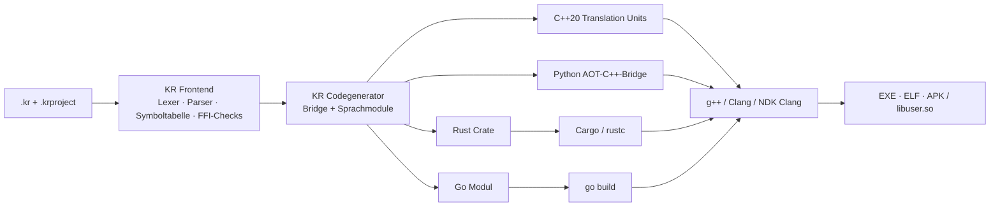

---

## Architektur im Überblick

KR besteht aus einer Desktop-IDE, der Headless-Compiler-Pipeline und ergänzenden IDE-/Agenten-Plugins.

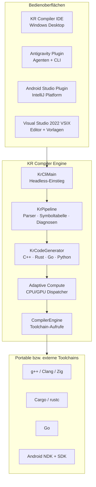

Die wichtigste Headless-Schnittstelle lautet:

```powershell
& 'H:\KR-Compiler\KR-Compiler-Windows-x64-v4.3.1\runtime\jdk\bin\java.exe' `
  -cp 'H:\KR-Compiler\KR-Compiler-Windows-x64-v4.3.1\dist\KR-Compiler-IDE.jar' `
  kr.compile.KrCliMain 'C:\src\MeinProjekt' WINDOWS
```

Syntax:

```text
KrCliMain <Projektordner> [WINDOWS|LINUX|ANDROID]
```

Alle drei Plugins verwenden diese Pipeline; sie enthalten absichtlich keinen konkurrierenden zweiten Compiler.

---

## Installation und Schnellstart

### Voraussetzungen

| Komponente | Erforderlich für | Prüfung |
|---|---|---|
| `runtime\jdk\bin\java.exe` | Start der IDE und Headless-Build | Datei muss im KR-Ordner vorhanden sein |
| `dist\KR-Compiler-IDE.jar` | KR-Pipeline | Datei muss im KR-Ordner vorhanden sein |
| `toolchain\` | C++, Rust, Go, Plattform-Build | Toolchain-Stempel und Compiler-Dateien vorhanden |
| Android SDK/NDK | Nur Android-APK | Android Studio SDK Manager |

Der Compilerordner kann über die Umgebungsvariable konfiguriert werden:

```powershell
[Environment]::SetEnvironmentVariable(
  'KR_COMPILER_HOME',
  'H:\KR-Compiler\KR-Compiler-Windows-x64-v4.3.1',
  'User'
)
```

Danach IDEs und Terminals neu öffnen.

### Desktop-IDE starten

| Startdatei | Zweck |
|---|---|
| `windows\Start-KR-IDE.bat` | Normaler Desktop-Start ohne sichtbare Konsole |
| `windows\Start-KR-IDE-Console.bat` | Start mit Konsole; hilfreich für Diagnose |
| `runtime\jdk\bin\java.exe -jar dist\KR-Compiler-IDE.jar` | Direkter Java-Start |

### Erster Build in fünf Schritten

1. KR Compiler IDE starten.
2. **Projekt → Neues Projekt erstellen** wählen und `SINGLE_KR`, `MODULAR_KR_FORGE` oder eine passende Vorlage anlegen.
3. `main.kr` öffnen.
4. Im Bereich **BUILD** das Ziel `Windows x64 (.exe)`, `Linux x64 (ELF)` oder `Android ARM64` wählen.
5. Build starten und das Ergebnis im Ordner `KR_BUILD\` kontrollieren.

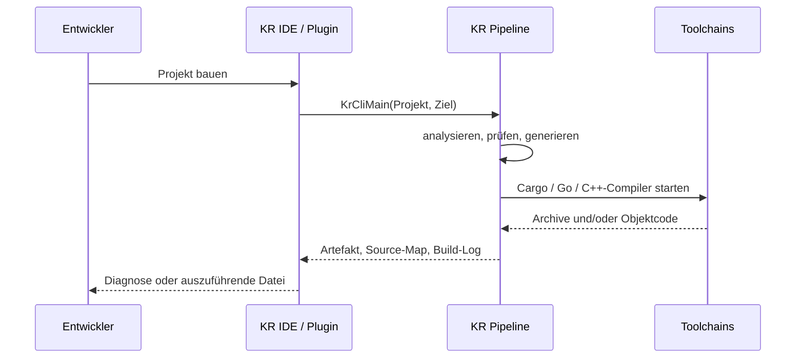

---

## Projektmodell und Dateien

Ein KR-Projekt besteht mindestens aus einer `.kr`-Quelldatei. Eine `.krproject`-Datei wird empfohlen, weil sie Name, Einstiegspunkt, GUI-Modus, Modulpfade und Abhängigkeiten festhält.

```text
MeinProjekt/
├── Project.krproject          # KR-Projektkonfiguration
├── main.kr                    # C++20 + Rust + Go + Python möglich
├── gui/                       # optionale KR-Module
├── assets/                    # optionale Laufzeitdaten
└── KR_BUILD/                  # ausschließlich generierte Daten
    ├── kr_bridge.h
    ├── kr_cpp.cpp
    ├── rust_module/
    ├── go_module/
    ├── python_module/
    ├── source_map.json
    ├── build.log
    └── <projekt>-<hash>.exe
```

### Beispiel: `Project.krproject`

```toml
[project]
name = "MeinProjekt"
version = "1.0.0"
entry = "main.kr"
target_type = "gui"       # console, gui, sdl3 oder window

[modules]
sources = ["app/", "gui/", "compute/"]

[dependencies]
packages = ["sdl3"]

[build]
cpp_standard = "c++20"
rust_edition = "2024"
go_version = "1.24"

[compute]
mode = "AUTO"              # AUTO, CPU_ONLY, GPU_ONLY, VERIFY
```

### Projektvorlagen der Desktop-IDE

| Vorlage | Zweck |
|---|---|
| `MODULAR_KR_FORGE` | Mehrmodul-Referenz mit `app/`, `gui/`, `research/`, `compute/`, `orchestration/`, `storage/` |
| `SINGLE_KR` | Kleinster KR-Einstieg mit `main.kr` |
| `CPP_PROJECT` | Reines C++20-/CMake-Projekt |
| `RUST_PROJECT` | Eigenständiges Cargo-Projekt |
| `GO_PROJECT` | Eigenständiges Go-Modul |

`KR_BUILD` ist Build-Ausgabe. Quelländerungen gehören in die Projektdateien **außerhalb** dieses Ordners; beim nächsten Build erzeugt KR die Ausgaben neu.

---

## Die vier Sprachen und ihre Grenzen

### Grundregel

Die Sprache einer Funktion folgt ihrer Aufgabe, nicht einer automatischen Optimierung durch den Compiler.

| Sprache | Typische Rolle | Von KR erzeugtes Ziel |
|---|---|---|
| C++20 | Einstiegspunkt, native APIs, SDL3/GUI, Performance-kritische Integration | C++ Translation Units, finale Link-Stufe |
| Rust | Regeln, sichere Rechenkerne, Ownership-kritische Logik | Rust-Crate → `libkr_rust.a` |
| Go | Dienste, Orchestrierung, einfache parallele Service-Logik | Go-Modul → `libkr_go.a` bzw. Android `libkr_go.so` |
| Python | Ausdrucksstarke Logik und Regeln | Python-Modul plus AOT Native C++20 Bridge |

### Ein minimales Vier-Sprachen-Beispiel

```cpp
#include <iostream>
#include <cstdint>

fn rust_add(a: i32, b: i32) -> i32 {
    a + b
}

func go_is_valid(value int32) bool {
    return value > 0
}

def python_bonus(value: int32) -> int32:
    return value + 1

int main() {
    int32_t sum = rust_add(40, 2);
    bool ok = go_is_valid(sum);
    int32_t result = python_bonus(sum);
    std::cout << "Result=" << result << std::endl;
    return ok ? 0 : 1;
}
```

### FFI-Regeln

1. Es gibt genau einen nativen Einstiegspunkt `main()` pro ausführbarem KR-Projekt.
2. Öffentliche Funktionsnamen müssen über alle Sprachsegmente eindeutig sein.
3. Verwende explizite ABI-nahe Typen: `i32`/`int32`, `i64`/`int64`, `f32`/`float`, `f64`/`double`, `bool`.
4. Übergib Besitz und Speicherverwaltung eindeutig. Keine versteckten, sprachspezifischen Objekte über die FFI-Grenze reichen.
5. Rust-`panic!` und unkontrolliertes `.unwrap()` gehören nicht in FFI-Pfade.
6. Fehler zuerst mit `KR_BUILD\build.log` und der gemappten Quelldatei beheben, nicht in generierten Dateien.

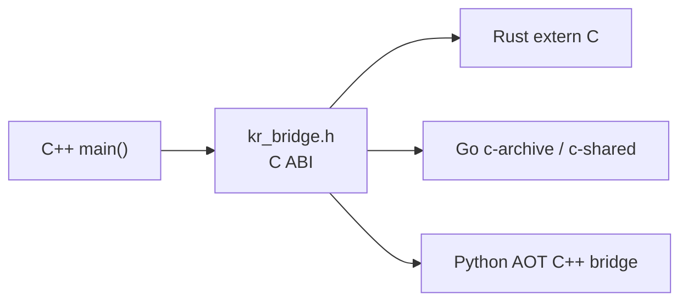

---

## Build-Pipeline und Zielplattformen

### Was während eines KR-Builds passiert

1. KR sucht `.kr`-Dateien und optional eine `.krproject`-Konfiguration.
2. Lexer und Parser zerlegen den Quelltext in Sprachsegmente.
3. Die Symboltabelle prüft Namen und Querverweise.
4. KR erzeugt `kr_bridge.h`, C++-Dateien, Rust-/Go-/Python-Module und eine Source-Map.
5. Rust und Go werden mit ihren nativen Backends gebaut.
6. Die C++-Toolchain linkt die generierten C++-Dateien, Archive und Plattformbibliotheken.
7. KR schreibt Artefakt, Log und Diagnoseinformationen nach `KR_BUILD`.

### Ziele

| Ziel | Ergebnis | C++-Backend | Zusätzliche Schritte |
|---|---|---|---|
| `WINDOWS` | `.exe` | Gebündeltes `g++` bzw. Clang | Kopiert bei SDL3-Bedarf `SDL3.dll` zu den Artefakten |
| `LINUX` | ELF-Binärdatei | Zig-/Clang-Cross-Toolchain | Rust-Cross-Target `x86_64-unknown-linux-gnu` |
| `ANDROID` | APK, `libuser.so`, ggf. `libkr_go.so` | Android NDK Clang | Android Runner, APK-Paketierung, ADB optional |

### Artefakte lesen

| Datei | Bedeutung |
|---|---|
| `KR_BUILD\build.log` | Vollständige Ausgabe aller Backend-Compiler |
| `KR_BUILD\source_map.json` | Zuordnung generierter Dateien zurück zu `.kr`-Quellen |
| `KR_BUILD\kr_bridge.h` | Von KR generierter C-ABI-Vertrag |
| `KR_BUILD\*.exe` / ELF / APK | Ausführbares Resultat |

---

## Konsolen- und GUI-Anwendungen

KR unterstützt nicht nur Konsolenprogramme. Ein GUI-Projekt setzt in der Konfiguration `target_type = "gui"` und verwendet z. B. SDL3.

```cpp
#include <SDL3/SDL.h>

int main() {
    if (!SDL_Init(SDL_INIT_VIDEO)) return 1;
    SDL_Window* window = SDL_CreateWindow("KR GUI", 900, 540, 0);
    if (window == nullptr) return 1;

    bool running = true;
    SDL_Event event;
    while (running) {
        while (SDL_PollEvent(&event)) {
            if (event.type == SDL_EVENT_QUIT) running = false;
        }
        SDL_Delay(16);
    }
    SDL_DestroyWindow(window);
    SDL_Quit();
    return 0;
}
```

Der KR-Compiler erkennt `SDL3/SDL.h` bzw. `SDL_Init`, verlinkt SDL3 und die nötigen Windows-Bibliotheken automatisch. Für Windows liefert der Build die benötigte `SDL3.dll` neben das Artefakt.

---

## Adaptive Compute: CPU/GPU, nicht Sprachwahl

KR kann konservativ bestimmte Rechenmuster erkennen: elementweise Operationen, Tensor-Operationen, Reduktionen, Matrixmultiplikation und 2D-Convolution. Dabei werden Lesesätze, Schreibziele, Schleifenform, Seiteneffekte und Aliasing-Risiken ausgewertet.

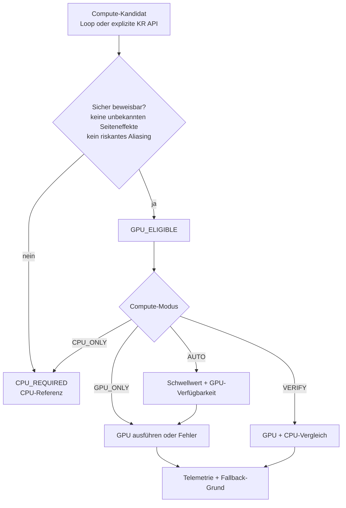

Die Entscheidung ist **CPU gegen GPU** innerhalb des gewählten Programmdesigns. KR entscheidet nicht, ob eine Entwicklerin Rust statt C++ hätte schreiben sollen. Das ist absichtlich so: Die Sprachwahl bleibt sichtbar, kontrollierbar und fachlich begründet.

| Modus | Bedeutung |
|---|---|
| `AUTO` | GPU ab geeigneter Arbeitsgröße; CPU-Fallback bei fehlender Eignung |
| `CPU_ONLY` | Immer CPU-Referenzpfad |
| `GPU_ONLY` | GPU erforderlich; bei Fehler kein stiller CPU-Wechsel |
| `VERIFY` | GPU-Ergebnis gegen CPU-Referenz prüfen; bei Abweichung absichern |

---

## KR Compiler IDE bedienen

### Startbildschirm, Projektzugriff und GitHub

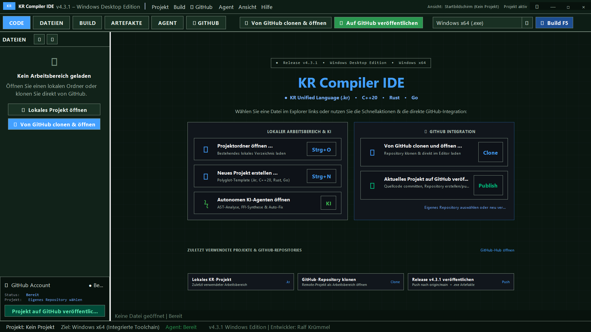

*Abbildung: Der Startbildschirm bietet die Bereiche **CODE**, **DATEIEN**, **BUILD**, **ARTEFAKTE**, **AGENT** und **GITHUB**. Projekte können lokal geöffnet oder aus einem GitHub-Repository geklont werden. Außerdem stehen die direkten Aktionen zum Anlegen eines Projekts, Öffnen des autonomen Agenten und Veröffentlichen eines Projekts auf GitHub bereit.*

Der Projekt-Explorer links zeigt den geladenen Arbeitsbereich. Oben wird die Zielplattform gewählt, beispielsweise **Windows x64 (.exe)**. Die Schaltfläche **Build F5** startet den Build für das aktuelle Projekt. Die GitHub-Aktionen sind an einen ausgewählten Account und ein Repository gebunden; sie sind keine Ersatzfunktion für den lokalen KR-Compiler.

### CODE

Der Editor bearbeitet `.kr`, `.cpp`, `.h`, `.rs`, `.go`, TOML und CMake. Syntaxhervorhebung, Tabs, Zeilennummern und Speichern sind für den direkten Projekt-Workflow ausgelegt.

### DATEIEN

Der Dateibaum verwaltet Projektdateien und Ordner. Verwende ihn für Quellen und Assets; Build-Artefakte werden anschließend im eigenen Bereich sichtbar.

### BUILD

Hier werden Zielplattform und Build gestartet. Die Live-Konsole ist die maßgebliche Quelle für Backend-Fehler. Bei einem Fehler:

1. erste KR- oder Backend-Diagnose lesen,
2. die darin genannte Originaldatei öffnen,
3. Quelle außerhalb von `KR_BUILD` ändern,
4. erneut bauen.

### ARTEFAKTE

Artefakte lassen sich ausführen, im Explorer anzeigen oder mit ihrem Log vergleichen. Dies ist der schnellste Weg, nach einem erfolgreichen Windows-Build die erzeugte EXE zu prüfen.

### AGENT

Der integrierte Agent arbeitet mit einer kontrollierten Werkzeugschleife (`list`, `read`, `write`, `build`, `done`). Dateiänderungen und Builds sind durch Freigaben und Audit-Protokoll nachvollziehbar. Der Agent soll Quellprojekte ändern, nicht die generierten Dateien in `KR_BUILD`.

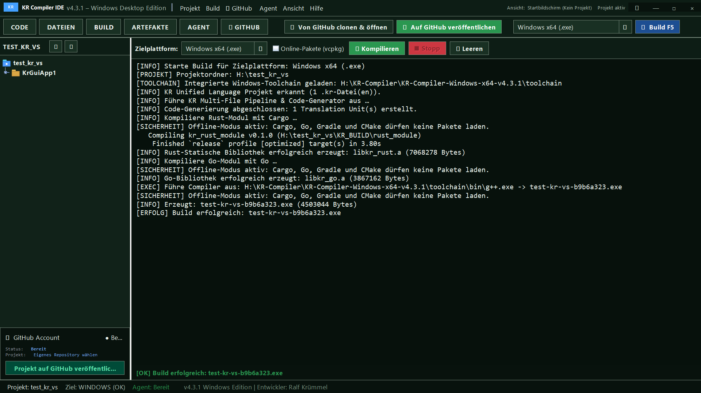

*Abbildung: Die Build-Konsole dokumentiert die echte Pipeline: KR erkennt die `.kr`-Quelle, erzeugt Translation Units, kompiliert das Rust-Modul mit Cargo sowie das Go-Modul und linkt anschließend mit `g++.exe` ein Windows-EXE-Artefakt. Der Build endet mit dem grünen Status **Build erfolgreich**.*

---

## Plugins: Überblick

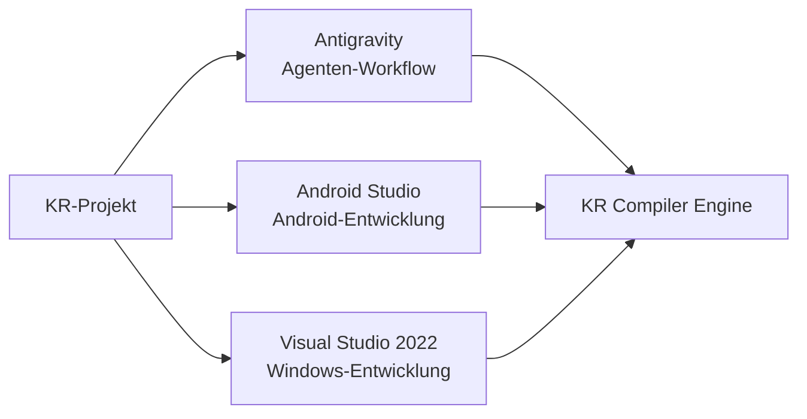

| Plugin | Hauptzweck | Installationsformat | Build-Anbindung |
|---|---|---|---|
| Antigravity | KI-Agenten verstehen KR, prüfen, bauen und reparieren | Antigravity-Pluginordner | `kr`-CLI → `KrCliMain` |
| Android Studio | `.kr`-Editor, Analyse, APK/ADB/Gradle | IntelliJ-/Android-Studio-Plugin ZIP | Compiler Bridge → `KrCliMain` |
| Visual Studio 2022 | Editor, Squiggles, Tool Window, Vorlagen, F5 | VSIX | Tool Window und Vorlagen-Skript → `KrCliMain` |

---

## Antigravity-Plugin

### Zweck

Das Plugin macht Antigravity-Agenten zu KR-fähigen Entwicklungspartnern. Es liefert Regeln für FFI, einen Skill für den Arbeitsablauf und den CLI-Helfer `kr`.

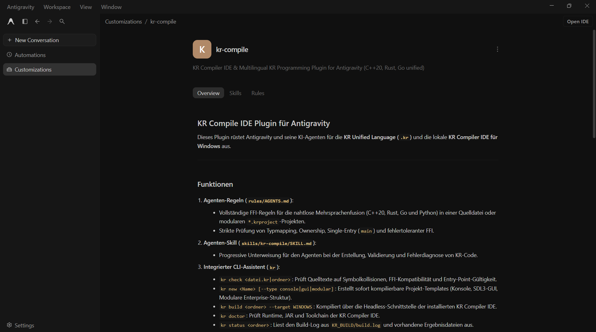

*Abbildung: Die Übersichtsseite bestätigt die Installation des Plugins und erläutert dessen Funktionen.*

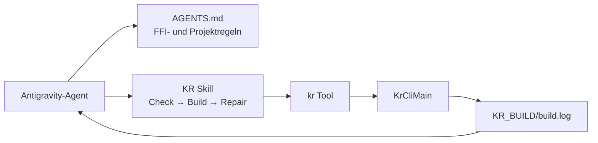

### Installation

1. Plugin nach `%USERPROFILE%\.gemini\config\plugins\kr-compile\` kopieren.
2. Antigravity neu starten.
3. Optional `skills\kr-compile\scripts\kr.cmd` nach `%USERPROFILE%\.gemini\antigravity\bin\kr.cmd` kopieren.
4. Diesen `bin`-Ordner in den Benutzer-`PATH` aufnehmen.
5. `KR_COMPILER_HOME` konfigurieren oder den Standardpfad verwenden.

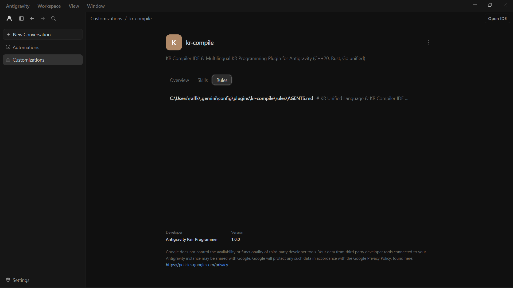

*Abbildung: Die Regelansicht zeigt, dass die FFI- und Projektvorgaben als `AGENTS.md` im Plugin geladen sind.*

### CLI-Referenz

```powershell
kr doctor
kr check C:\src\MeinProjekt
kr new MeineApp --type console
kr new MeineGui --type gui
kr new MeinForge --type modular
kr build C:\src\MeinProjekt --target WINDOWS
kr status C:\src\MeinProjekt
```

| Befehl | Wirkung |
|---|---|
| `kr doctor` | Prüft Runtime, JAR und Toolchain |
| `kr check` | Prüft Symbole, FFI-Kompatibilität und Einstiegspunkt |
| `kr new` | Erzeugt Console-, SDL3-GUI- oder modulare Vorlage |
| `kr build` | Startet den echten KR-Headless-Build |
| `kr status` | Liest Log und Artefakte |

**Agentenablauf:** `doctor` → `check` → `build` → Log/Diagnose lesen → echte Quelldatei ändern → erneut `build`.

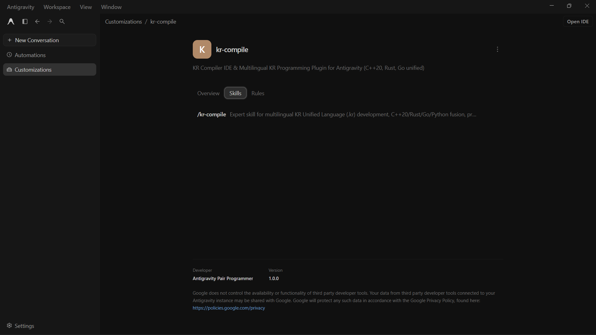

*Abbildung: Der Skill `/kr-compile` vermittelt Agenten den KR-spezifischen Arbeitsablauf.*

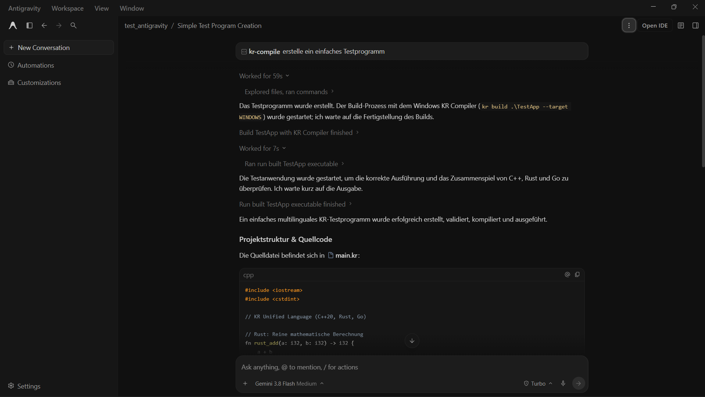

*Abbildung: Nachweis eines vollständigen Agentenablaufs von der Testprogrammerstellung bis zur Ausführung.*

Das installierbare Paket und die zugehörige Versionshistorie stehen im [GitHub-Release v4.3.1-studio](https://github.com/kruemmel-python/KR-Compiler-Windows-x64-v4.3.1/releases/tag/v4.3.1-studio) bereit.

---

## Android-Studio-Plugin

### Zweck und Voraussetzungen

Das Android-Studio-Plugin ist eine dreischichtige Brücke aus Editor, Compiler Bridge und Android Build Adapter. Es benötigt die KR Compiler IDE als Engine; das Plugin enthält keine zweite Toolchain.

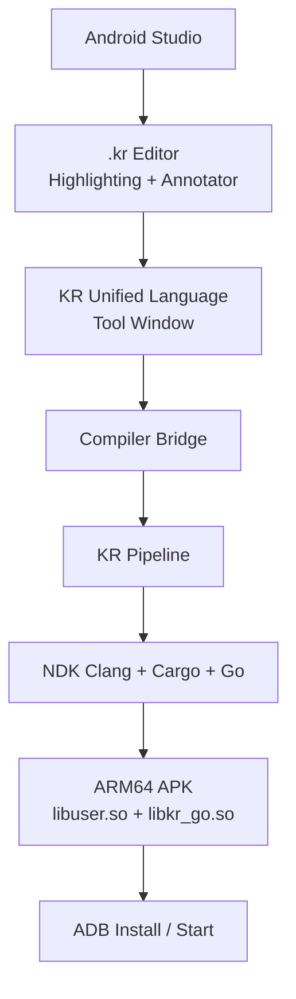

Benötigt werden:

- KR Compiler IDE inklusive `runtime`, `dist` und `toolchain`,
- Android Studio auf IntelliJ-Basis,
- Android Platform Tools, Build Tools und NDK,
- `KR_COMPILER_HOME` oder die Engine-Pfadauswahl im Tool Window.

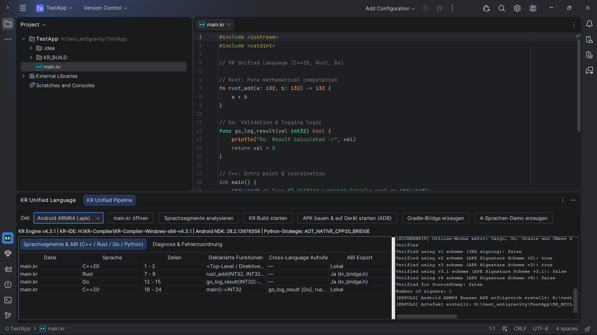

*Abbildung: Das Tool Window zeigt Sprachsegmente, ABI-Informationen und die Build-Ausgabe für ein Android-ARM64-Artefakt.*

### Installation

1. Android Studio öffnen.
2. **Settings → Plugins → Zahnrad → Install Plugin from Disk…**.
3. `KR-Unified-Language-AndroidStudio-Plugin-v4.3.1.zip` wählen.
4. Neustart bestätigen.
5. Im Tool Window **KR Unified Language** den KR-Engine-Pfad festlegen, falls er nicht automatisch gefunden wird.

### Typischer Android-Workflow

1. Beispielprojekt `examples\KR_ANDROID_STUDIO_4LANG_DEMO` über **File → Open…** öffnen.
2. `main.kr` bearbeiten.
3. Ziel **Android ARM64 (.apk)** auswählen.
4. **KR Build starten** oder den Gradle-Run verwenden.
5. Optional **APK bauen & auf Gerät starten (ADB)**.

Die vollständige Android-spezifische Dokumentation liegt bereits im Repository:

- [`DOKUMENTATION-Android-Studio-Plugin.md`](../DOKUMENTATION-Android-Studio-Plugin.md)
- [`KR_Android_Studio_Handbuch.md`](../KR_Android_Studio_Handbuch.md)

---

## Visual-Studio-2022-Plugin

### Funktionsumfang

Die VSIX-Erweiterung **KR Unified Language** erweitert Visual Studio Community 2022 um:

- Zuordnung für `.kr` und `.krproject`,
- Syntaxfarben für C++20, Rust, Go, Python und ABI-Typen,
- direkte Editor-Markierungen für doppelte Symbole, mehrere `main()` und riskante Rust-FFI-Muster,
- **Tools → KR Unified Language** mit Compilerpfad, Zielauswahl, Build-Ausgabe und Build-Log,
- **Tools → KR: Aktuelles Projekt bauen**,
- Vorlagen **KR Unified Console Application** und **KR Unified GUI Application**.

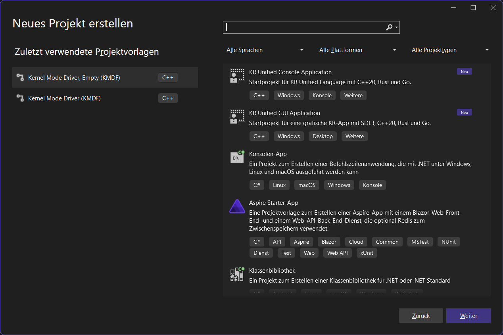

*Abbildung: Beide KR-Vorlagen erscheinen im Dialog **Neues Projekt erstellen**: Konsole und SDL3-GUI.*

### Installation

1. Visual Studio schließen.
2. `KR-Unified-Language-Visual-Studio-2022-v1.0.3.vsix` doppelklicken.
3. **Visual Studio Community 2022** als Ziel bestätigen.
4. Visual Studio neu starten.
5. `KR_COMPILER_HOME` konfigurieren oder in **Tools → KR Unified Language** den Ordner wählen.

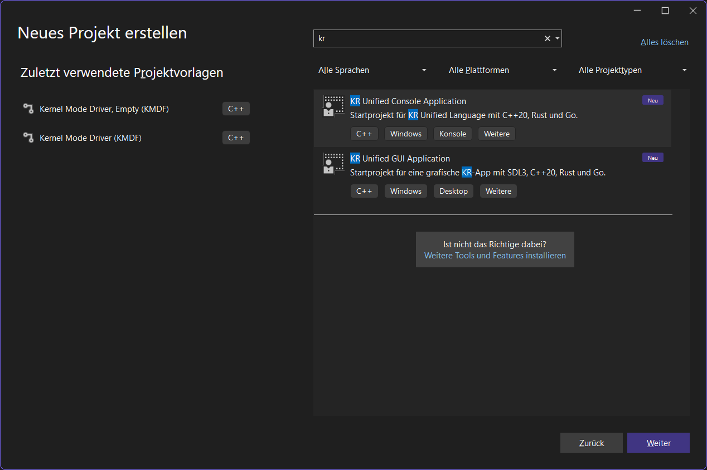

*Abbildung: Mit der Suche `kr` werden beide KR-Vorlagen gefiltert angezeigt.*

### Projektvorlagen und F5

In **Datei → Neu → Projekt** nach `KR Unified` suchen:

| Vorlage | Inhalt |
|---|---|
| `KR Unified Console Application` | KR-Konsolenstart mit C++20, Rust und Go |
| `KR Unified GUI Application` | SDL3-Fenster mit C++20, Rust und Go; `target_type = "gui"` |

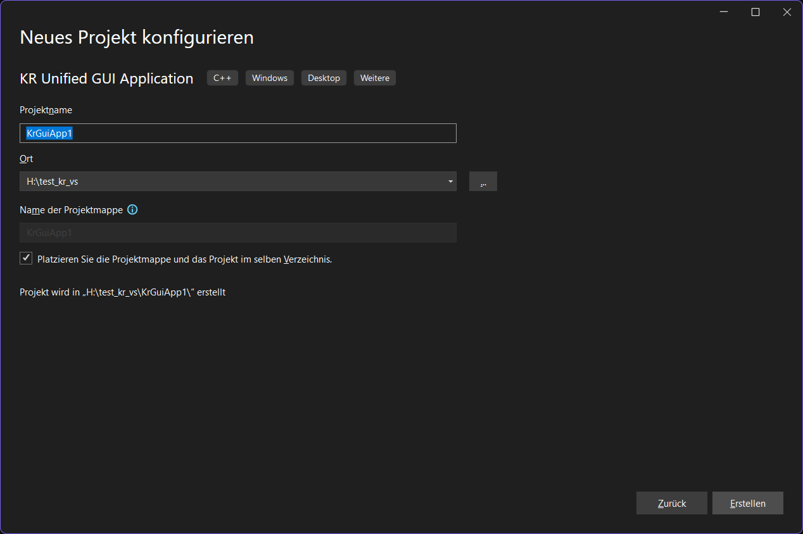

*Abbildung: Die GUI-Vorlage wird mit Projektname und Zielordner eingerichtet.*

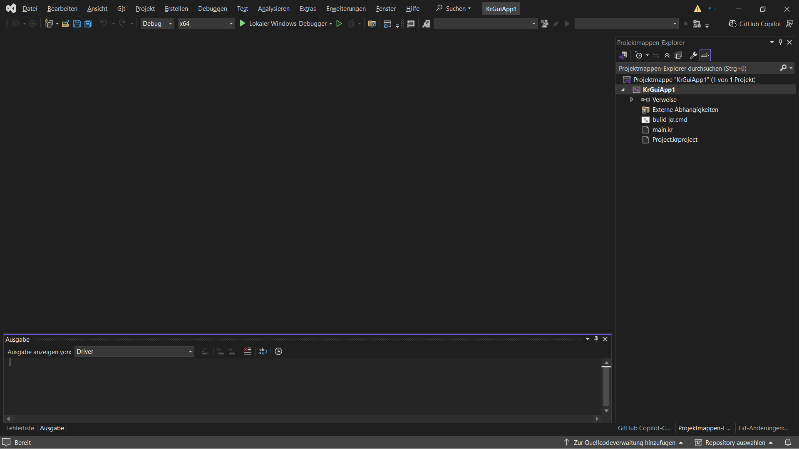

*Abbildung: Nach dem Erstellen liegt die KR-Projektstruktur im Projektmappen-Explorer vor.*

Bei Projekten, die mit der aktuellen Vorlage erzeugt werden, ruft **Build** den KR-Compiler auf. Anschließend wird dessen EXE als Visual-Studio-Debugziel nach `x64\<Konfiguration>\<Projektname>.exe` kopiert. **F5** startet dieses Ergebnis.

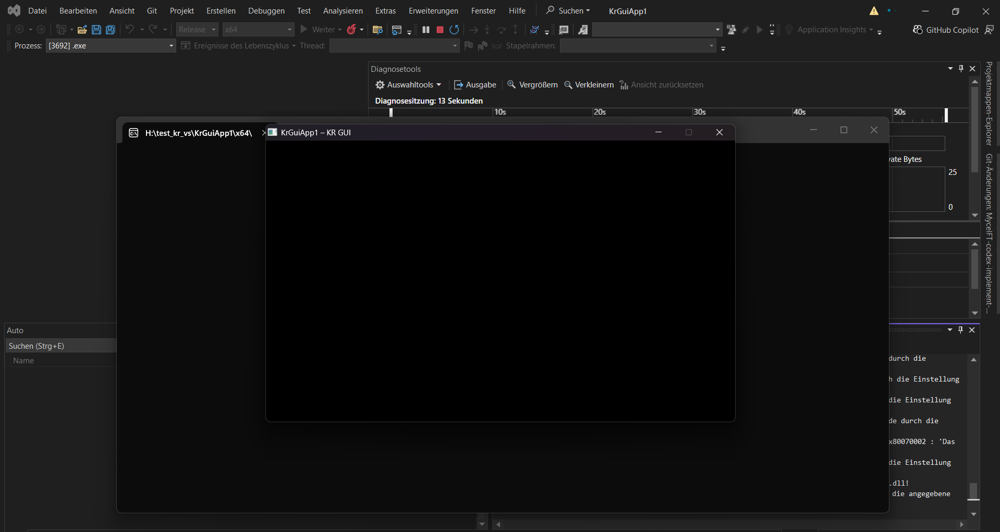

*Abbildung: Die SDL3-GUI wird aus Visual Studio heraus als Debugziel gestartet.*

> Bestehende Projekte werden beim Plugin-Update nicht stillschweigend umgeschrieben. Für die neue Vorlagen-Buildintegration ein neues KR-Vorlagenprojekt anlegen oder den KR-Build über **Tools → KR: Aktuelles Projekt bauen** nutzen.

Das installierbare VSIX sowie das ZIP mit Quell- und Installationsdokumentation stehen im [GitHub-Release v4.3.1-studio](https://github.com/kruemmel-python/KR-Compiler-Windows-x64-v4.3.1/releases/tag/v4.3.1-studio) bereit.

---

## Diagnose, Fehlerbehebung und sichere Arbeitsweise

### Reihenfolge bei Fehlern

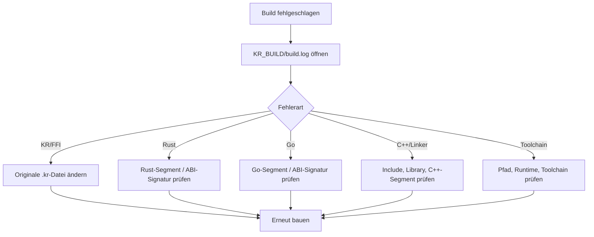

### Häufige Ursachen

| Symptom | Wahrscheinliche Ursache | Lösung |
|---|---|---|
| `KR_COMPILER_HOME` ungültig | Ordner ohne `runtime`, `dist` oder `toolchain` | Umgebungsvariable bzw. IDE-Pfad korrigieren |
| `main` mehrfach definiert | Mehrere C++-/Sprachsegmente besitzen Einstiegspunkt | Genau einen nativen Einstiegspunkt behalten |
| Symbolkollision | Gleicher öffentlicher Funktionsname in mehreren Segmenten | Namen eindeutig machen oder Modulgrenzen klären |
| Rust-/Go-Linkfehler | ABI-Typen oder Export nicht kompatibel | C-ABI-nahe Signaturen verwenden |
| SDL3 nicht gefunden | GUI-Abhängigkeit/Toolchain unvollständig | `#include <SDL3/SDL.h>`, `sdl3`-Abhängigkeit und Toolchain prüfen |
| Android APK startet nicht | SDK/NDK/ABI oder ADB-Konfiguration | Android Tool Window und `build.log` prüfen |
| Visual Studio F5 findet keine EXE | Projekt stammt nicht aus aktueller KR-Vorlage | Neues Vorlagenprojekt nutzen oder KR-Build über Tools starten |

### Sicherheitsprinzipien

- Toolchains und JAR nur aus vertrauenswürdigen Releases beziehen.
- Build-Caches bleiben in `KR_BUILD\.cache` auf dem Projektlaufwerk.
- Offline-Modus verhindert, dass Cargo, Go, Gradle und CMake ungefragt Pakete laden.
- Generierte Dateien nicht manuell als dauerhafte Quelle pflegen.
- Agentenänderungen und Buildstarts nachvollziehbar freigeben.

---

## Release- und Projekt-Checkliste

### Vor einem Projekt-Release

- [ ] `KR_COMPILER_HOME` verweist auf eine vollständige, getestete KR-Version.
- [ ] Windows-Build erfolgreich; EXE gestartet.
- [ ] Linux-Build erfolgreich, falls Linux ausgeliefert wird.
- [ ] Android-APK gebaut und auf realem Gerät/Emulator gestartet, falls Android ausgeliefert wird.
- [ ] `KR_BUILD/build.log` ohne unbehandelte Fehler geprüft.
- [ ] Genau ein Einstiegspunkt und eindeutige FFI-Symbole.
- [ ] GUI-Projekte enthalten SDL3-Laufzeitdateien neben dem Windows-Artefakt.
- [ ] Nur Quellen, Assets und Konfiguration versioniert; `KR_BUILD` als generierte Ausgabe behandeln.

### Vor einem Plugin-Release

- [ ] Plugin verweist auf die erwartete KR-Compiler-Version.
- [ ] Installation in der Ziel-IDE getestet.
- [ ] `.kr`-Highlighting und Diagnose geprüft.
- [ ] Ein Vier-Sprachen-Beispiel gebaut.
- [ ] GUI-Vorlage gebaut und gestartet.
- [ ] Dokumentation, Versionsnummer und Release-Asset aktualisiert.

---

## Weiterführende Dateien im Repository

| Thema | Datei |
|---|---|
| Hauptübersicht und Desktop-IDE | [`README.md`](../README.md) |
| Android-Studio-Plugin | [`DOKUMENTATION-Android-Studio-Plugin.md`](../DOKUMENTATION-Android-Studio-Plugin.md) |
| Android-Studio-Schritt-für-Schritt-Handbuch | [`KR_Android_Studio_Handbuch.md`](../KR_Android_Studio_Handbuch.md) |
| Beispielprojekte | [`examples/README-Beispielprojekte.md`](../examples/README-Beispielprojekte.md) |
| Adaptive Compute Tests | [`tests/adaptive_compute/README.md`](../tests/adaptive_compute/README.md) |

Dieses Handbuch beschreibt die reale aktuelle Architektur: KR ist der einheitliche Projekt-, Analyse- und Build-Orchestrator; die bewährten C++-, Rust- und Go-Backends erzeugen den plattformspezifischen Maschinencode.
