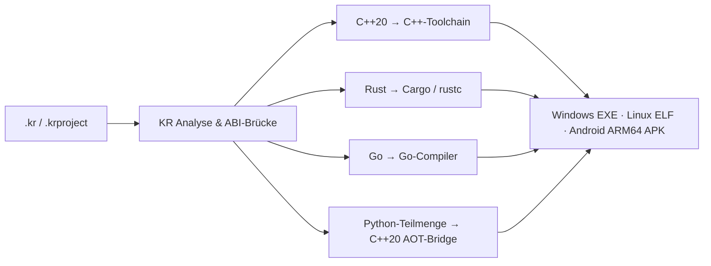

# KR Unified Language (`.kr`)

## Entwickler-Leitfaden für C++20, Rust, Go und Python

**Gültig für KR Compiler IDE v4.3.2**

KR Unified Language verbindet vier Sprachbereiche in einer `.kr`-Datei oder einem modularen `.krproject`-Projekt:

- **C++20** für native Anwendungsteile, Datenstrukturen und Performance-kritische Logik,
- **Rust** für Algorithmen, Validierung und speichersichere Komponenten,
- **Go** für Orchestrierung, Nebenläufigkeit und Dienste,
- **Python** für eine bewusst AOT-kompilierbare Teilmenge von Steuerungs- und Berechnungslogik.

Der KR-Compiler erkennt die Bereiche anhand der Syntax, analysiert Deklarationen und Aufrufe projektweit, erzeugt C-kompatible ABI-Brücken und ruft anschließend die jeweiligen Backend-Toolchains auf. KR ersetzt Clang, Cargo/rustc oder Go nicht; es koordiniert die Sprachgrenzen und den Zielplattform-Build.



## 1. Sprachbereiche erkennen

Es sind keine künstlichen Marker wie `@cpp` oder `@rust` erforderlich. Die Pipeline verwendet typische Konstrukte:

| Bereich | Typische Erkennung |
| --- | --- |
| C++20 | `#include`, `class`, `namespace`, Templates, C/C++-Funktionsdefinitionen |
| Rust | `fn`, `pub fn`, `let`, `match`, `impl`, `trait`, `println!`, `i32`, `f64` |
| Go | `func`, `package`, `import`, Go-Typen, Goroutinen und Channels |
| Python | `def`, `import`, `from … import`, Einrückungsblöcke und Python-Ausdrücke |

Ein Projekt darf mehrere `.kr`-Dateien enthalten. Eine optionale Datei `projekt.krproject` legt Einstiegspunkt, Modulordner und Build-Einstellungen fest.

## 2. Rollen der Sprachen

| Sprache | Geeignete Aufgaben | Hinweise |
| --- | --- | --- |
| C++20 | native UI, Speicherpuffer, SIMD, Bibliotheksanbindung, Programmeinstieg | Die natürliche Heimat für komplexe native Objekte |
| Rust | mathematische Kerne, Parser, Zustandsautomaten, Validierung | Keine Panics über ABI-Grenzen weitergeben |
| Go | Worker, Logging, I/O-Orchestrierung, Nebenläufigkeit | Kein zweites `main()` definieren |
| Python | Berechnungs- und Steuerungsfunktionen, Schleifen, Bedingungen, einfache Ausdrücke | AOT-Teilmenge; kein allgemeiner CPython-Laufzeitmodus |

## 3. Python in KR

Python ist seit der 4-Sprachen-Edition Bestandteil der KR-Sprache. Python-Segmente werden analysiert und durch `KrPythonTranspiler` in eine native C++20-Bridge überführt. Das Ergebnis enthält:

- den nachvollziehbaren Quellartefakt `KR_BUILD/python_module/kr_python_module.py`,
- `execution_strategy.json` mit der gewählten Ausführungsstrategie,
- die native Datei `KR_BUILD/python_module/kr_python_bridge.cpp`.

Für Android lautet die Strategie **`AOT_NATIVE_CPP20_BRIDGE`**. Die Funktionen werden als native ABI-Symbole in `libuser.so` eingebunden; auf Windows und Linux werden sie in das jeweilige native Zielprogramm integriert. Es wird dabei **kein vollständiger CPython-Interpreter** in die App oder Binärdatei gepackt.

### Unterstützter, sinnvoller Python-Stil

Die AOT-Umsetzung ist für klar strukturierte Funktionen gedacht. Verwende:

- `def` mit einfachen Parametern und Rückgabewerten,
- Zuweisungen und Rückgaben,
- `if` / `elif` / `else`, `while` und `for … in range(...)`,
- arithmetische und Vergleichsausdrücke,
- `print(...)`, `abs`, `min` und `max`,
- Aufrufe von KR-exportierten C++-, Rust- und Go-Funktionen.

Nicht als allgemeine Python-Implementierung behandeln: dynamische Imports zur Laufzeit, Reflektion, Klassenmetaprogrammierung, externe Python-Pakete, `eval`, Generatoren und CPython-Erweiterungen gehören nicht zum garantierten AOT-Umfang.

```python
# Python-Segment in main.kr
def python_clamp(value: float, limit: float) -> float:
    if value > limit:
        return limit
    return max(0.0, value)
```

Die Funktion kann anschließend aus einem C++-, Rust- oder Go-Bereich mit ABI-kompatiblen Parametern aufgerufen werden.

## 4. Sprachübergreifende Aufrufe

KR erzeugt die erforderlichen Wrapper aus Symboltabelle und Aufrufbeziehungen. Manuelle FFI-Deklarationen wie `extern "C"`, `#[no_mangle]` oder `//export` sind für die KR-Integration nicht notwendig.

Regeln:

1. **Namen sind projektweit eindeutig.** Verwende beispielsweise `cpp_render`, `rust_validate`, `go_log` und `python_clamp`.
2. **Über Sprachgrenzen nur ABI-kompatible Werte verwenden.**
3. **Ein Programmeinstieg.** Typisch ist `int main()` im C++-Bereich; kein zusätzliches `func main()` in Go.
4. **Fehler als Werte zurückgeben.** C++-Exceptions und Rust-Panics dürfen keine ABI-Grenze überschreiten.

### ABI-Typen

| Konzept | C++20 | Rust | Go | Python-AOT | ABI |
| --- | --- | --- | --- | --- | --- |
| Boolean | `bool` | `bool` | `bool` | `bool` | `uint8_t` |
| 32-Bit Integer | `int32_t` | `i32` | `int32` | `int` | `int32_t` |
| 64-Bit Integer | `int64_t` | `i64` | `int64` | `int` | `int64_t` |
| 32-Bit Float | `float` | `f32` | `float32` | `float` | `float` |
| 64-Bit Float | `double` | `f64` | `float64` | `float` | `double` |
| kein Rückgabewert | `void` | `()` | weglassen | `None` | `void` |

Komplexe C++-Objekte, Go-GC-Zeiger und dynamische Python-Objekte werden nicht by-value übergeben. Für große Datenmengen stattdessen Rohzeiger plus Länge und eine eindeutige Ownership-Regel verwenden: **Wer allokiert, gibt frei.**

## 5. Vier-Sprachen-Beispiel

```cpp
#include <iostream>
#include <cstdint>

fn rust_add(a: i32, b: i32) -> i32 {
    a + b
}

func go_is_positive(value int32) bool {
    println("Go: Ergebnis =", value)
    return value > 0
}

def python_limit(value: int, maximum: int) -> int:
    return min(value, maximum)

int main() {
    int32_t sum = rust_add(40, 2);
    int32_t limited = python_limit(sum, 100);
    bool ok = go_is_positive(limited);
    std::cout << "Status: " << (ok ? "SUCCESS" : "FAIL") << std::endl;
    return ok ? 0 : 1;
}
```

## 6. Modulare Projekte

Beispiel einer `projekt.krproject`:

```toml
[project]
name = "KR_FORGE"
version = "1.0.0"
entry = "main.kr"

[modules]
scan_directories = ["app", "compute", "orchestration"]

[build]
cpp_standard = "c++20"
optimization = "O3"
```

Die Pipeline sammelt dabei C++-Translation-Units, das Rust-Crate, das Go-Modul und gegebenenfalls die Python-AOT-Bridge. Gemeinsame Symbole werden vor dem Plattform-Link geprüft.

## 7. Zielplattformen und Build

| Ziel | Ergebnis |
| --- | --- |
| Windows x64 | native `.exe` |
| Linux x64 | native ELF-Binärdatei |
| Android ARM64 | APK mit nativen Bibliotheken |

Die Windows-IDE bietet die Auswahl im Build-Bereich. Android Studio nutzt zusätzlich seinen KR-Build-Adapter. Für die vollständige Plattformverteilung siehe den [Release v4.3.2](https://github.com/kruemmel-python/KR-Compiler-Windows-x64-v4.3.1/releases/tag/v4.3.2).

## 8. Fehlerdiagnose

| Symptom | Typische Ursache | Lösung |
| --- | --- | --- |
| Symbol nicht gefunden | Tippfehler oder nicht ABI-kompatible Signatur | Funktionsname und skalare Typen prüfen |
| Symbolkollision | derselbe Funktionsname in mehreren Bereichen | Namen mit Sprach-/Modulpräfix eindeutig machen |
| Zweites `main()` | C++- und Go-Einstieg zugleich | genau einen Einstiegspunkt behalten |
| Native Ausnahme | Exception/Panic über Sprachgrenze | lokal abfangen und Statuswert zurückgeben |
| Python-AOT-Fehler | Python außerhalb der unterstützten Teilmenge | Funktion auf einfache AOT-Konstrukte reduzieren |

## 9. Checkliste

- [ ] `.kr`-Dateien und optional `.krproject` angelegt
- [ ] genau ein Programmeinstieg definiert
- [ ] Funktionsnamen projektweit eindeutig
- [ ] Sprachübergreifende Signaturen auf ABI-Skalare begrenzt
- [ ] Python-Code auf die AOT-Teilmenge begrenzt
- [ ] Zielplattform gewählt und Build-Protokoll geprüft

## Weiterführende Dokumentation

- [KR Compiler IDE Handbuch](KR-Compiler-IDE-Handbuch.md)
- [Android-Studio-Plugin-Dokumentation](../DOKUMENTATION-Android-Studio-Plugin.md)
- [Release Notes v4.3.2](../RELEASE_NOTES-v4.3.2.md)
